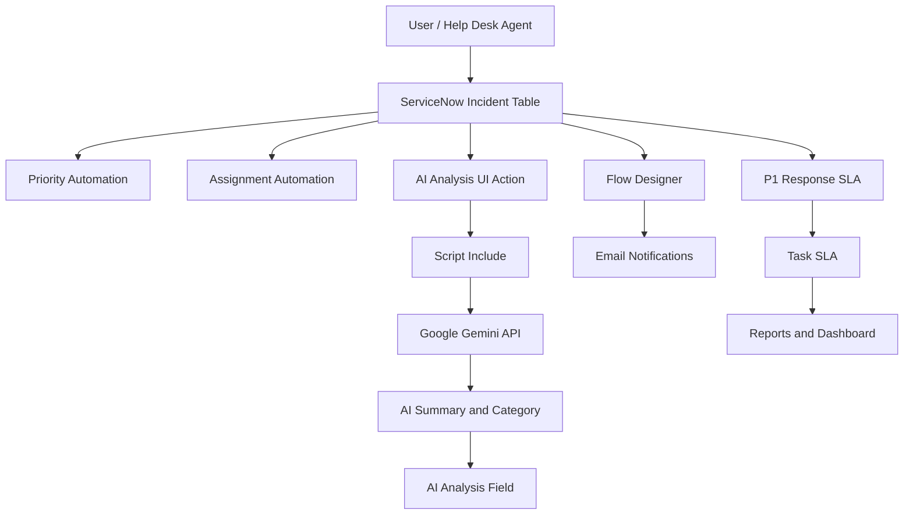
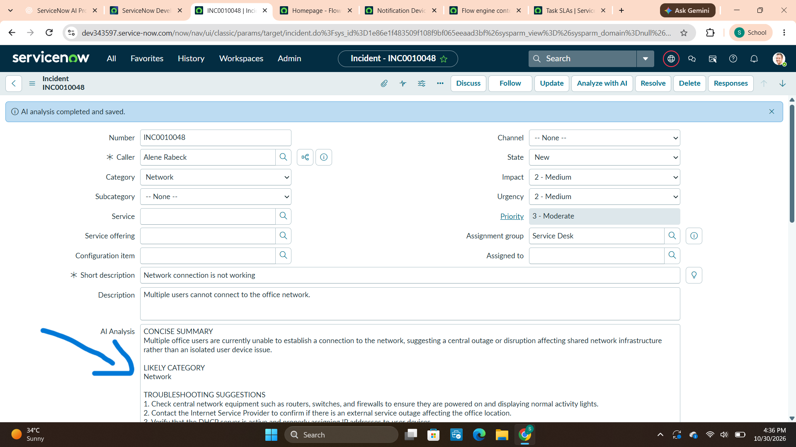

# AI-Assisted IT Help Desk Management System

**A ServiceNow-based incident management solution integrating workflow automation, SLA monitoring, email notifications, dashboards, and Google Gemini AI.**

## Project Overview

The AI-Assisted IT Help Desk Management System is a ServiceNow Personal Developer Instance (PDI) project designed to improve IT incident handling through automation and AI-assisted analysis.

It uses the ServiceNow Incident table to manage support requests, automate priority calculation, and route incidents to appropriate support groups.

An external Google Gemini API integration generates incident summaries, likely categories, and troubleshooting suggestions to assist help desk agents.

This is a learning and demonstration project, not a production deployment package.

## Key Features

- **Incident Management:** Create, update, and track IT incidents using the ServiceNow Incident table.
- **Priority Automation:** Calculate incident priority based on impact and urgency.
- **Assignment Automation:** Route tested network incidents to the Network group and printer incidents to Service Desk.
- **Gemini AI Integration:** Generate incident summaries, likely categories, and troubleshooting suggestions.
- **Email Notifications:** Send custom notifications when new incidents are created.
- **SLA Management:** Track critical incidents using a P1 Response SLA.
- **Reports and Dashboards:** Monitor incident priorities, incident states, and SLA performance.

## Technology Stack

| Technology | Purpose |
|---|---|
| ServiceNow PDI | Development platform |
| Incident Table | Incident management |
| Client Scripts | Client-side form behavior |
| Business Rules | Server-side automation |
| Flow Designer | Workflow automation |
| ServiceNow SLA / Task SLA | SLA monitoring |
| Google Gemini API | AI-assisted incident analysis |
| JavaScript | ServiceNow scripting |
| Reports and Dashboards | Operational monitoring |

## System Architecture

## AI Integration

The project integrates Google Gemini API with ServiceNow using:

- Script Include: `AIHelpDeskGeminiService`
- Connection Alias: `Gemini_AI_Help_Desk_Connection`
- UI Action: Triggers AI analysis for the selected incident.
- AI Analysis field: Stores the generated response.

The generated analysis includes:

1. Incident summary.
2. Likely incident category.
3. Suggested troubleshooting steps.

AI output is advisory and should be reviewed by a support agent.

## Example Workflow

1. A user creates an IT incident.
2. ServiceNow evaluates impact and urgency.
3. Priority automation calculates the incident priority.
4. Assignment automation routes the tested incident type to the appropriate support group.
5. The support agent requests AI analysis using the UI Action.
6. Gemini generates an incident summary and troubleshooting suggestions.
7. The analysis is saved in the incident record.
8. The notification process sends an email to the configured recipient.
9. The P1 Response SLA tracks critical-incident response.
10. Reports and dashboards provide operational visibility.

## Screenshots

### Incident Management

### Priority and Assignment Automation

### Gemini AI Analysis

### P1 Response SLA

### Operations Dashboard

### Breached SLA Report

## Project Documentation

- [View Project Documentation (PDF)](AI_Assisted_IT_Help_Desk_Project_Documentation%20%281%29.pdf)
- [View Editable Project Documentation (DOCX)](AI_Assisted_IT_Help_Desk_Project_Documentation.docx)

## Testing and Validation

The following functional scenarios were tested in the ServiceNow PDI.

| Test Scenario | Observed Result | Status |
|---|---|---|
| High impact and high urgency | Priority 1 - Critical | PASS |
| Network incident | Assigned to Network | PASS |
| Medium impact and medium urgency | Priority 3 - Moderate | PASS |
| Printer incident | Assigned to Service Desk | PASS |
| Gemini AI analysis | Summary and suggestions generated | PASS |
| Network AI category | Network | PASS |
| P1 Response SLA | Timer started; initially not breached | PASS |
| Operations dashboard | Three widgets displayed data | PASS |
| Breached SLA report | Records displayed using Has breached = true | PASS |
| Custom email notification | Delivered to alternate recipient | PASS |

**Note:** These results reflect the observed tests in the development instance. They do not represent exhaustive testing or production readiness.

## Security Considerations

- API keys and credentials are stored using ServiceNow connection and credential configuration.
- Sensitive credentials must never be committed to GitHub.
- AI-generated suggestions should be reviewed by a human agent.
- Access to incident records and AI analysis should follow appropriate roles and ACLs.
- Gemini API quota and availability may affect integration requests.

## Limitations

- Developed and tested in a free ServiceNow Personal Developer Instance.
- Gemini free-tier quota limitations may cause HTTP 429 or 503 errors.
- Assignment automation has been validated with representative test cases.
- Email delivery depends on instance email configuration and recipient restrictions.
- The project is intended for learning and demonstration purposes.

## Future Enhancements

- Expand incident assignment rules.
- Add AI confidence scoring.
- Introduce human approval before applying AI recommendations.
- Add fallback handling for API failures.
- Implement automated regression testing.
- Add SLA escalation notifications.
- Integrate knowledge base recommendations.

## Author

**Chagal Samreen**

B.Tech – Computer Science and Engineering (Data Science)

---

*Developed as a hands-on ServiceNow and external AI integration project.*
