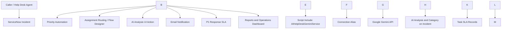

# AI-Assisted IT Help Desk Management System

> A ServiceNow-based incident management solution that combines workflow
> automation, SLA monitoring, email notifications, operational
> dashboards, and external Google Gemini AI assistance.

## Overview

The **AI-Assisted IT Help Desk Management System** is a ServiceNow
Personal Developer Instance (PDI) project designed to make IT incident
handling more consistent and efficient.

It uses the ServiceNow Incident table as the central record for support
requests. Configured automation calculates incident priority and routes
tested incident types to support groups. An external Gemini API
integration generates an AI-assisted incident summary, likely category,
and troubleshooting suggestions. The application also includes a custom
incident email notification, a P1 response SLA, reports, and an
operations dashboard.

This repository documents the project design, implementation approach,
and observed test results. It is a learning/demo project and is **not a
production deployment package**.

## Key Features

* **Incident management:** Track incidents using the ServiceNow
Incident table.
* **Priority automation:** Tested impact/urgency combinations produce
the expected priority.
* **Assignment routing:** Tested network incidents route to the
Network group; tested printer incidents route to Service Desk.
* **Gemini AI analysis:** Generate an incident summary, likely
category, and troubleshooting suggestions.
* **Custom email notification:** Send a custom incident-created
notification to the configured recipient.
* **P1 response SLA:** Track SLA stage, business time remaining,
elapsed percentage, and breach status.
* **Reports and dashboard:** Visualize total incidents, incidents by
priority/state, and breached SLA records.

## Architecture



## Technology Stack

\---

Component                            Purpose

\---

ServiceNow Personal Developer        Application platform and
Instance                             development environment

Incident table (`incident`)          Central incident records

Client Scripts / Business Rules      Form behavior and server-side
automation, where configured

Flow Designer                        Workflow and assignment automation

Script Include                       Server-side Gemini integration
(`AIHelpDeskGeminiService`)

Connection Alias                     Connection configuration reference
(`Gemini\\\_AI\\\_Help\\\_Desk\\\_Connection`)

Google Gemini API                    AI-assisted incident analysis

ServiceNow Notifications / Email     Incident email communication

Task SLA                             SLA tracking

## Reports and Dashboards               Operational monitoring

## Example Workflow

1. A caller or help desk agent creates an incident with a short
description, description, impact, and urgency.
2. ServiceNow evaluates the configured priority logic.
3. Assignment automation routes the incident according to the
configured conditions.
4. The agent invokes the AI analysis action on the incident.
5. The server-side Script Include sends the relevant incident
information to Gemini through the configured connection.
6. The generated analysis is saved to the incident's **AI Analysis**
field; the category is populated or suggested according to the
implementation.
7. The notification process generates an email for its configured
recipient.
8. Critical incidents are tracked by the P1 response SLA.
9. Reports and dashboard widgets provide operational visibility.

## Validation Results

The following are the observed results from the project test run. They
validate the listed scenarios only; they do not represent exhaustive
testing.

\---

Test                    Expected result         Observed result

\---

High impact + high      Priority 1 - Critical   Passed
urgency

Network connectivity    Assignment group:       Passed
incident                Network

Medium impact + medium  Priority 3 - Moderate   Passed
urgency

Printer incident        Assignment group:       Passed
Service Desk

Gemini analysis action  AI summary and          Passed
suggestions generated

Network AI category     Category: Network       Passed

P1 response SLA         In Progress and not     Passed
breached at observation
time

Operations dashboard    Total, priority, and    Passed
state widgets display  
data

Breached-SLA report     Filter uses             Passed
`Has breached = true`

Custom email            Custom email received   Passed
notification            at alternate recipient  
address
---

**Note:** Dashboard and report totals can include pre-existing PDI
records and may change over time.

## Repository Structure

Suggested structure for this GitHub repository:

``` text
ai-assisted-it-help-desk/
├── README.md
├── docs/
│   ├── project-documentation.pdf
│   ├── project-documentation.docx
│   ├── architecture.md
│   └── test-cases.md
├── screenshots/
│   ├── incident-form.png
│   ├── priority-and-assignment.png
│   ├── gemini-ai-analysis.png
│   ├── p1-response-sla.png
│   ├── operations-dashboard.png
│   ├── breached-sla-report.png
│   └── custom-email-notification.png
└── servicenow/
    ├── README.md
    └── export-notes.md
```

Only add files and screenshots that you have actually prepared. Do not
upload secrets, personal data, or unredacted email addresses.

## Setup and Configuration Notes

This project was configured in a ServiceNow PDI. Reproducing it requires
access to a ServiceNow instance and appropriate permissions to create
application components.

The Gemini integration requires a valid Google AI API key and a
correctly configured ServiceNow connection/credential. **Do not commit
API keys, passwords, tokens, credential records, or exported secrets to
GitHub.** Configure credentials securely in your own instance.

The exact configuration of flows, scripts, field names, SLA schedules,
and UI actions should be reviewed in the instance before attempting to
recreate the project. This repository is documentation of the
implementation, not a one-click installer.

## Security and Limitations

* AI-generated analysis is advisory. A support agent should review
suggestions before taking action.
* Gemini API availability and usage quotas can affect requests.
* The PDI has email sending and recipient restrictions; email behavior
may differ from production instances.
* Assignment routing has been validated with representative network
and printer examples. More cases should be tested.
* A Personal Developer Instance is intended for learning and
demonstration, not production service delivery.

## Future Enhancements

* Expand assignment rules for additional incident categories and
keywords.
* Add AI confidence indicators and human approval before changing
incident fields.
* Add robust handling for API quota errors, timeouts, and malformed
responses.
* Add more automated test cases and regression checks.
* Add trend analytics for resolution time, reassignment, and SLA
compliance.
* Add escalation alerts and knowledge article recommendations.

## Project Documentation

See the [`docs/`](docs/) folder for the detailed project report,
architecture notes, and test evidence.

## Author

**Chagal Samreen**
B.Tech -- Computer Science and Engineering (Data Science)  
GitHub: *https://github.com/sam-0522/AI-Assisted-IT-Help-Desk*

\---

If you find this project useful, feel free to explore the documentation
and test scenarios.

